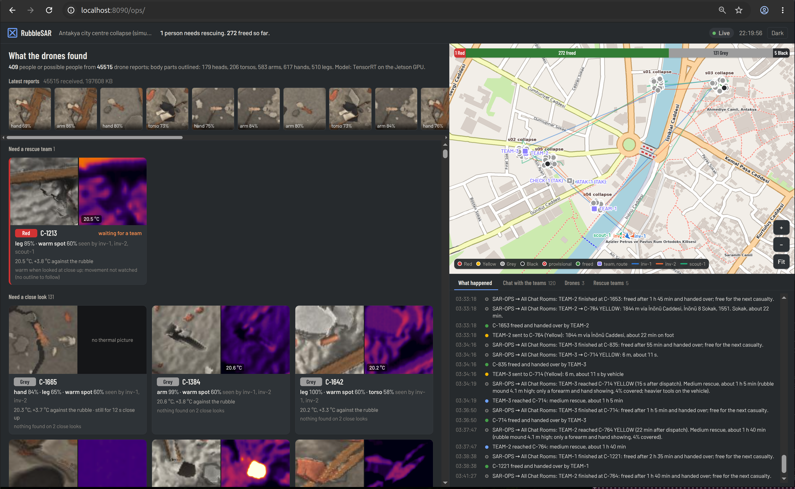
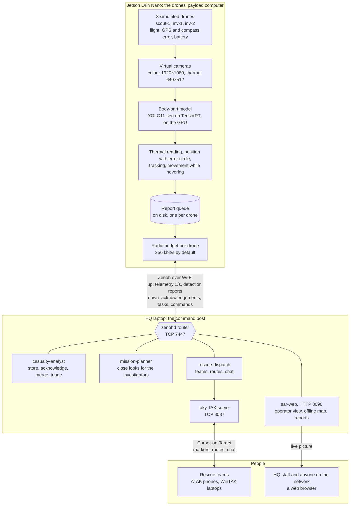
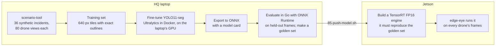
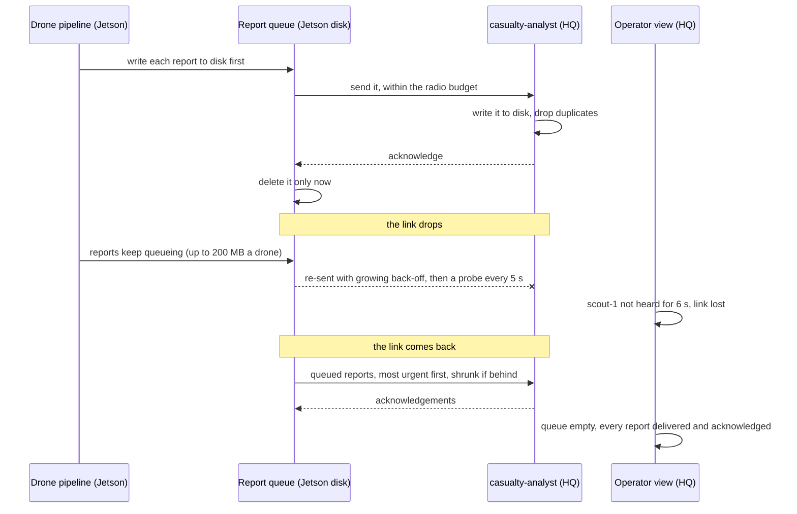
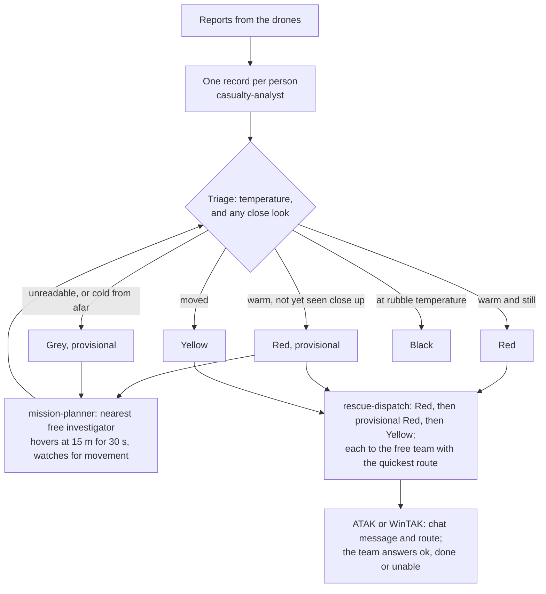

# RubbleSAR

**Drones that find people trapped in rubble, and send rescue teams to them.**

RubbleSAR is an end-to-end simulation of drone-assisted urban search and rescue after an earthquake:

- **On the drones:** a Jetson Orin Nano processes the images for three simulated drones.
- **At headquarters (HQ):** a standard laptop turns the drones' reports into casualty records, close-look tasks for the drones, and rescue tasks.
- **For the rescuers:** they follow it all on the devices they already carry (ATAK on Android, WinTAK on Windows) or in a web browser.

No internet connection is needed during an incident.


<p align="center">
  </img>
</p>

> **Everything here is simulated.** The incident, the victims, the drones' flight and cameras, and the rescue teams are all generated. The body-part model has only seen synthetic images. It is not a validated casualty detector and must not be used for real decisions. Triage thresholds and rescue times are illustrative and have not had medical review.

## The demo video

A narrated walk-through of one simulated mission, about five minutes long. It covers the scenario, the drones and what their cameras see, the model on the Jetson, the radio link with a blackout, the HQ programs, the rescue teams on ATAK, and the after-action report.

<!-- To embed the video: edit this file on github.com and drag docs/media/rubblesar-demo.mp4 (made by
     tools/readme/make-readme-media.sh to fit the upload limit) onto the empty line below. GitHub uploads it
     and inserts a https://github.com/user-attachments/assets/... link, which it shows as a video player. -->


*The video's map is drawn from OpenStreetMap data, © OpenStreetMap contributors (ODbL).*

---

## How it works

1. **The scout surveys.** A scout drone flies over each collapsed building at 40 m. It takes the shortest round trip from its home.
2. **The model looks.** On the Jetson, every frame goes through a segmentation model that outlines hands, arms, legs, heads and torsos. The thermal camera tells warm skin from cold rubble.
3. **Each body part becomes a small report.** A report of about 5 KB holds:
   - a position with an honest error circle;
   - the temperature against the rubble around it;
   - small colour and thermal crops, and the outline.

   The full camera frames never leave the drone.
4. **Reports travel to HQ.** They go to the HQ laptop over Zenoh, within each drone's radio budget. If the link drops, they wait on board until HQ has confirmed each one.
5. **HQ builds one record per person.** It merges what different drones saw and suggests a START triage colour.
6. **Investigators take a close look.** Wherever a closer look could change the answer, an investigator drone hovers at 15 m for 30 s and watches for movement.
7. **Rescue teams go.** Red and Yellow casualties each get the free rescue team with the quickest route, along streets clear of rubble. A team with ATAK or WinTAK receives the task as a chat message with a route on its map, and answers `ok`, `done` or `unable`.

## Architecture



| Machine | Program | What it does |
|---|---|---|
| Jetson | `edge-eye` | Hosts the simulated drones. For each drone: flight, cameras, the model, thermal reading, position, tracking, movement checks and the report queue. Sends telemetry once a second. |
| HQ laptop | `zenohd` | The Zenoh router: every message between the Jetson and the HQ programs passes through it. |
| HQ laptop | `casualty-analyst` | Stores every report and acknowledges it once it is on disk. Merges reports into one record per person and suggests a triage colour. |
| HQ laptop | `mission-planner` | Sends investigator drones to the casualties that need a close look. |
| HQ laptop | `rescue-dispatch` | Sends rescue teams along streets clear of rubble. Puts casualties, drones, teams, routes and chat on the TAK map. |
| HQ laptop | `rubblesar-taky` | The taky TAK server (in Docker), shared by ATAK, WinTAK and rescue-dispatch. |
| HQ laptop | `sar-web` | Serves the live operator view, the offline incident map and the after-action reports. |
| HQ laptop | `rubblesar` | Starts and stops both machines, records missions and their reports, and directs the recording of the demo video. |
| both | `sar-check`, `sar-doctor` | Acceptance tests for every phase, and an environment check with fixes. |

The HQ programs are written in Go. They run on an ordinary x86-64 Ubuntu laptop without a GPU; the GPU is only needed to train the model (below). The HQ laptop's setup scripts are in `scripts/zbook/`, and the Jetson's in `scripts/jetson/`.

---

## Machine learning on the drones (Jetson)

The Jetson does all the image work, on behalf of every drone, so the radio only has to carry conclusions. For each drone, once a second:

| Step | What happens |
|---|---|
| 1. Capture | The virtual cameras render the drone's view: colour at 1920×1080, and a radiometric thermal image at 640×512 that measures temperature. From 40 m that is about 3 cm a pixel. The drone's *reported* position drifts like real GPS and compass errors do. |
| 2. Segment | The frame is cut into six 640-pixel tiles, and the tiles go through a **YOLO11 segmentation network** on the Jetson's GPU with **TensorRT (FP16)**. It outlines **hands, arms, legs, heads and torsos**, each with a confidence score. On the Orin Nano a whole frame takes about **115 ms** (median; 230 ms at the 90th percentile), and the three drones share one model. |
| 3. Read the heat | Under each outline, the thermal image gives the part's temperature against the rubble around it: a part reads as warm at 20–40 °C and at least 3 °C above its surroundings. Warm spots that no outline covers become thermal-only candidates. |
| 4. Place it | Each part is placed on the map with an error circle (CEP). The circle is worked out from the GPS, heading, altitude and gimbal errors, and from the unknown height of the rubble. The acceptance test requires a median position error under 5 m. |
| 5. Follow it | A tracker follows parts from frame to frame. A part is reported once and updated only when it changes. |
| 6. Watch for movement | While an investigator hovers, each frame is aligned to the first, and each part is compared with its surroundings. This tells a moving limb from a model's outline flickering. |
| 7. Report | The result is a report of about 3–5 KB: class, confidence, position and CEP, temperature, outline, a colour crop of 128 px or less, and a thermal crop. |

The tiling, decoding, non-maximum suppression and masks are Go code, the same on both machines. Only the network itself runs in TensorRT, called through a small C shim. The Jetson runs everything natively, without Docker.

## Machine learning on the HQ laptop

The HQ laptop is where the model is **made, checked and handed to the drones**:



- **Training data is synthetic, and generated here.** `scenario-tool` builds 36 incidents (30 for training, 6 for validation), varying the seeds, buildings, victims, time of day, weather and the share of living victims. It photographs each one from 80 drone positions at different heights and angles, with noise and blur. Every body part is written as an exact outline. The incident used in the demo is never trained on: it is the held-out test.
- **Training** fine-tunes Ultralytics YOLO11-seg (version pinned, starting weights checked by hash) in a Docker container on the laptop's GPU. It then exports to ONNX. Training takes one to three hours.
- **Checking** runs in Go with ONNX Runtime on the CPU, scoring the held-out frames per class, per view and per person.
  - A golden set of twelve reference tiles goes to the Jetson with the model, and the Jetson's TensorRT engine must give the same answers.
  - Ultralytics' own predictions on those tiles prove that the Go decoding matches Python's.
- **For the video and the after-action review,** `rubblesar demo media` renders a drone's frame again from its recorded position, and runs the same model on it with ONNX Runtime. This shows exactly what the drone saw and what the model found.

**During a mission the HQ laptop runs no model.** The drones send conclusions, not frames, so there is nothing at HQ to run it on, and that is the point: it keeps the radio traffic small. HQ's own decisions use explicit, testable rules:

- merging sightings into one record per person: matching each drone's records as a group (the Hungarian method), so two people a few metres apart are not merged into one;
- triage from the temperature and from what a close look showed;
- shortest-path routing.

So the HQ laptop needs a GPU only for training.

---

## Communications: from the Jetson to the HQ laptop

### Transport

- **Zenoh 1.9** carries every message, encoded as **Protocol Buffers**.
- The router (`zenohd`) runs on the HQ laptop, on TCP 7447. The Jetson connects out to it, so it needs no open ports.
- The Jetson retries for ever, which means the two machines can start in any order, and a link that comes back reconnects by itself.
- Time is kept in step by chrony, served from the HQ laptop.

| Key expression | From → to | What | How often |
|---|---|---|---|
| `sar/{incident}/uav/{uav}/telemetry` | drone → HQ | position, battery, task, link budget and use, queue, model speed | once a second |
| `sar/{incident}/uav/{uav}/detection` | drone → HQ | one detection report (a body part or a warm spot) | when something is new or changed |
| `sar/{incident}/uav/{uav}/ack` | HQ → drone | which reports are safely on HQ's disk | batched, every 200 ms |
| `sar/{incident}/uav/{uav}/control`, `…/control/reply` | HQ → drone, and back | tasks (fly to, hover over, watch), budgets, test commands | on demand |
| `sar/{incident}/casualties`, `…/casualty/{id}` | casualty-analyst → all | casualty records with triage | on change, and the whole list periodically |
| `sar/{incident}/tasks` | mission-planner → all | close-look tasks | on change, every 5 s |
| `sar/{incident}/dispatch` | rescue-dispatch → all | teams and assignments | on change |

### How little is sent

| | Size |
|---|---|
| One colour and thermal frame from one drone | about 0.5 MB, which at one frame a second would be about **4 Mbit/s** per drone |
| One detection report | about **3–5 KB** with crops; under 1 KB as metadata only |
| A drone with nothing new to report | about **3 kbit/s** (telemetry) |
| One drone on average over a whole mission | **3.5 to 11 kbit/s**, at most about 100 kbit/s in any 5 seconds |
| All three drones on average | about **24 kbit/s**, against a budget of 256 kbit/s per drone |

*These figures were measured on a recorded 27-minute simulated mission.*

What keeps the traffic this low:

- the frames are processed on the Jetson and never sent;
- a part is reported once and updated only when it changes;
- crops are small;
- messages are compact binary;
- there is no video stream and no discovery traffic, because addresses are always explicit.

The radio itself is emulated. The machines talk over Wi-Fi, and each drone's traffic is metered by a token bucket set to its radio budget, which can be changed while it runs.

### When the link is poor

Each drone's budget is shared in a fixed order:

1. **Telemetry goes first.** It always keeps a reserve; the newest telemetry message replaces an unsent one.
2. **Reports follow, most urgent first:**
   1. new, warm and confident parts (most likely a living person);
   2. other new parts;
   3. updates to reports already sent;
   4. thermal-only warm spots.
3. **When the queue falls behind, reports shrink instead of being dropped:**

| Queue behind by | Reports are sent as |
|---|---|
| less than 10 s of budget | full: colour crop up to 128 px, thermal crop, outline (3–5 KB) |
| 10 s | small: colour crop up to 64 px |
| 30 s | thermal crop and outline only |
| 60 s | metadata only (under 1 KB): position, class, temperature, confidence |

### When the link drops and comes back



- **Nothing is lost.**
  - Every report is on the drone's disk before it is first sent.
  - It is deleted only when HQ confirms that the report is on *its* disk.
  - The queue survives restarts.
- **The drones carry on.** The survey and close-look missions run on board, so a drone keeps flying and looking while the link is down.
- **Everyone can see the outage.** HQ notices the silence within 6 seconds, and the operator view shows the drone as "not heard". When the link returns, the view says how many reports were waiting, and later that the queue is empty.
- **HQ re-plans around it.** A task given to a drone that does not answer, or stops making progress, goes back to the queue for another drone.
- **Rescue teams are covered too.** A TAK team that stops reporting its position for 3 minutes goes offline, and its casualty goes to another team. So does a casualty the team has not answered within 3 minutes.

**How this is tested:**
- `sar-check phase3` cuts every drone's link for 60 s, then drops the budget to 32 kbit/s for 90 s. It checks that no report is lost and that no drone ever exceeds its budget.
- The demo's live take cuts the scout's budget to 24 kbit/s for a minute, then blacks out its link for a minute. In the recorded take, no report was lost.

---

## What people see

| | ATAK (Android) and WinTAK (Windows) | RubbleSAR's operator view (any browser) |
|---|---|---|
| **For** | rescue teams, on the devices they already carry | anyone else on the network: HQ staff, a tablet, a wall screen |
| **Drones** | moving markers with battery and task; orange lines from an investigator to the casualty it is checking | position, heading and recent track; the scout's planned survey as a numbered dashed line; battery, task, link and reports waiting on board |
| **Casualties** | markers in their triage colour (`C-007 RED`, `RED?` while provisional), with the reason, how sure the position is and the rescue state; green once freed | a card per casualty, most urgent first: the colour and thermal pictures the drone sent, the body parts the model outlined and how sure it was, the temperature against the rubble, movement, and what is being done |
| **Teams** | simulated teams, and each team's route in its casualty's colour | teams, routes and states |
| **Map** | an offline map drawn on the HQ laptop from OpenStreetMap (zoom 13–19). It is loaded on the device as MBTiles, or streamed from the HQ laptop, and shows the rubble and the streets it closes. | the same offline map, with the collapses named after their streets |
| **Talking** | chat with SAR-OPS (rescue-dispatch's callsign): a direct message and a route for each task; replies `ok`, `status`, `unable`, `done` | the chat, and a plain-language timeline ("C-004 found by scout-1, provisional Red…", "TEAM-2 sent to C-004: 340 m, about 6 min") |

Both update live: the TAK markers on every change (refreshed every 30 s), and the operator view through server-sent events. The operator view needs no install or login, and also has a presenter mode used to record the demo video. After every mission, `rubblesar` writes an after-action report as a web page:

- who was found, against the simulated truth;
- who was reached and freed, and how long each step took;
- estimated real rescue times;
- false alarms.

---

## Coordinating drones and teams



**The survey.** The scout visits the collapse sites in the shortest round trip from its home. Up to eight sites, every order is tried. Beyond that, the order is nearest-neighbour, improved with 2-opt.

**Close looks.** mission-planner creates a task for every casualty that a look could change. The tasks come in three tiers:

1. possibly alive (provisional Red);
2. temperature unknown;
3. position too uncertain (CEP over 5 m).

How the tasks are given out:
- Each task goes to the nearest free investigator that will still have 25 % battery after the task and the flight home.
- Within a tier, the task nearest a free drone goes first, so the drones work through a site instead of crossing the incident. A look that has waited 4 minutes goes first in its tier.
- A more urgent task can take a drone that is on its way to a less urgent one.
- No casualty gets more than two looks.

**Triage.** START colours, suggested for a person to confirm:

| What the readings show | Colour |
|---|---|
| moved while watched close up | **Yellow** (trapped, responsive) |
| warm, watched close up for 20 s, no movement | **Red** |
| warm, not yet seen close up | **Red**, provisional: needs a look |
| at rubble temperature after a close look | **Black** |
| temperature unreadable, or cold seen only from afar | **Grey**, provisional: needs a look |

**Sending teams.**
- **Who goes first:** settled Red, then provisional Red, then Yellow. Black and Grey never get a team.
- **Which team:** for each casualty in that order, the free team with the quickest route goes.
- **Staying the course:** a team keeps its casualty until it is done. A more urgent casualty waits for the next free team instead of pulling a team away.
- **Changes:** when two records turn out to be the same person, the team follows the merged record. When a casualty no longer needs a team, the team is withdrawn.
- **How long it takes:** freeing someone is estimated at 15 minutes to 6 hours, from how the building collapsed and how deeply the person is buried. Handing them over takes 10 more minutes.
- **Who the teams are:**
  - *Simulated teams* walk or drive their routes, faster than real time.
  - *TAK teams* are real people whose callsign is listed: their position comes from their device, and they answer in the chat.

## Choosing routes

rescue-dispatch routes in Go itself. There is no routing server, and it works with no internet during the incident.

1. **The streets.** They come from OpenStreetMap, downloaded once, and are cut into pieces of at most 10 m.
2. **What rubble closes.** Every piece within 1 m of a rubble spill area is closed. The spill area is the collapsed building plus 5 m.
3. **The route.** A Dijkstra search by **travel time**, not distance, runs from the team's position to the open street point nearest the casualty (the *access point*). The last stretch is on foot.
4. **The speeds.**
   - On foot: 1.4 m/s on streets, half that on steps, 1.0 m/s on open ground and 0.5 m/s over rubble.
   - Vehicles: 10–30 km/h by street class (50 km/h on a motorway). They keep to one-way streets and stay off footways and steps, and their crews walk the last stretch.
5. **The result.** The quickest route decides which team goes. The chat message names the streets ("420 m via Kurtuluş Caddesi, about 6 min"). A casualty that no open street reaches is reported in the chat.

---

## Software used

| Component | Version | Where | Role | Licence |
|---|---|---|---|---|
| Go | 1.26 | both | all services and tools | BSD-3-Clause |
| Eclipse Zenoh: zenoh-c and zenohd | 1.9.0 | both | messaging between the Jetson and the HQ laptop | EPL-2.0 or Apache-2.0 |
| Protocol Buffers (protobuf-go) | 1.36.12 | both | message encoding | BSD-3-Clause |
| BurntSushi/toml | 1.6.0 | both | configuration | MIT |
| NVIDIA JetPack, TensorRT | 6.2.2, 10.3 | Jetson | runs the model on the GPU (FP16) | NVIDIA licence |
| ONNX Runtime (CPU) | 1.22.0 | both | model evaluation, golden set, the video's frames | MIT |
| Ultralytics YOLO11-seg | 8.3.253 | HQ, Docker | training and ONNX export | AGPL-3.0 |
| PyTorch (CUDA image) | 2.9.1 | HQ, Docker | training back end | BSD-3-Clause |
| taky | 0.10 | HQ, Docker | TAK server (Cursor-on-Target over TCP) | MIT |
| ATAK-CIV, WinTAK-CIV | current releases | rescuers' devices | the rescue teams' map and chat | from the TAK Product Center (tak.gov) |
| OpenStreetMap data (Overpass API) | downloaded once | HQ | streets for routing; the offline map | ODbL 1.0 |
| Python 3 with Pillow | | HQ | draws the offline map (offline tooling only) | PSF, MIT-CMU |
| Barlow typeface | | HQ, sar-web | operator view | SIL OFL 1.1 |
| chrony, systemd, Docker | Ubuntu's | both | time sync, services, containers | various |
| OBS Studio, scrcpy, ffmpeg | OBS 28 or later | HQ, optional | recording the demo video | GPL-2.0, Apache-2.0, LGPL/GPL |

The machines are a **Jetson Orin Nano** (JetPack 6.2.2, Ubuntu 22.04) and an **x86-64 laptop with Ubuntu** (tested on 26.04). The laptop needs an NVIDIA GPU only for training. Go modules are vendored, and downloads are pinned and checked against SHA-256 hashes (`VERSIONS.env`).

## Running it

Setting up is done in phases, each with numbered scripts and an acceptance test that ends in `RESULT: PASS`:

| Phase | Runbook | What it sets up |
|---|---|---|
| 0 | [docs/PHASE0.md](docs/PHASE0.md) | Zenoh link, simulated drones, link throttling |
| 1 | [PHASE1](docs/PHASE1.md) | the simulated incident and virtual cameras |
| 2 | [PHASE2](docs/PHASE2.md) | the model |
| 3 | [PHASE3](docs/PHASE3.md) | the onboard pipeline and store-and-forward |
| 4 | [PHASE4](docs/PHASE4.md) | casualty records, triage, investigators |
| 5 | [PHASE5](docs/PHASE5.md) | rescue teams, routes, the TAK server, ATAK and WinTAK |
| 6 | [PHASE6](docs/PHASE6.md) | one command for both machines, the offline map, after-action reports |
| 7 | [PHASE7](docs/PHASE7.md) | the live operator view |
| 8 | [PHASE8](docs/PHASE8.md) | recording the demo video |

Every port, file, service and configuration key is in [docs/ENVIRONMENT.md](docs/ENVIRONMENT.md), and every error code with its fix is in [docs/TROUBLESHOOTING.md](docs/TROUBLESHOOTING.md).

```bash
make build        # bin/ (needs zenoh-c installed)
make test         # unit tests, zenoh tests and inference back-end tests
make test-unit    # unit tests only, no zenoh needed
make vet          # go vet and gofmt
```

## Repository layout

```
cmd/              one folder per program (edge-eye, casualty-analyst, mission-planner, rescue-dispatch,
                  sar-web, rubblesar, sar-check, sar-monitor, sar-doctor, scenario-tool, sar-infer)
internal/edge     edge-eye: drones, perception loop          internal/perceive  thermal cue, geolocation, tracker
internal/infer    TensorRT and ONNX Runtime back ends        internal/outbox    store-and-forward queue
internal/bus      messaging, with a cgo shim over zenoh-c    internal/linkbudget the radio budget
internal/casualty fusion and triage                          internal/planner   close-look tasks
internal/dispatch rescue teams and the TAK picture           internal/roads     streets, closures, routes
internal/web      sar-web and the operator view              internal/live      the live picture and replays
internal/scenario the simulated incident                     internal/render, internal/vcam  imagery and cameras
internal/dataset  training-set generator                     internal/check     acceptance tests
proto/sar/v1      message schemas                            training/          training container
tools/map         offline map renderer                       configs/, deploy/  configuration, services
scripts/jetson, scripts/zbook   numbered setup and test scripts for the Jetson and the HQ laptop
```

## Limits and security

- **Simulation only.** The drones, their cameras and the radio link are simulated. The model has never seen a real image.
- **No encryption or login yet.** Zenoh, the TAK link and sar-web use plain TCP and HTTP. Use them only on a private network. TLS for Zenoh is described in [docs/ENVIRONMENT.md](docs/ENVIRONMENT.md#tls-for-the-field); TAK over SSL is still to do.
- **One incident at a time.** The scenario is set in central Antakya, Türkiye, a city heavily damaged in the February 2023 earthquakes. The collapses and the people in them are invented.

## Licence

RubbleSAR is licensed under the [GNU Affero General Public License v3.0](LICENSE). Its training uses Ultralytics YOLO11, which Ultralytics licenses under AGPL-3.0, and Ultralytics states that models trained with it fall under the same terms.

## Acknowledgements

- Map data © [OpenStreetMap](https://www.openstreetmap.org/copyright) contributors, under the ODbL.
- [Eclipse Zenoh](https://zenoh.io), [Ultralytics](https://github.com/ultralytics/ultralytics), [taky](https://github.com/tkuester/taky), [ONNX Runtime](https://onnxruntime.ai), and the [Barlow](https://github.com/jpt/barlow) typeface.
- ATAK and WinTAK are developed by the TAK Product Center. NVIDIA, Jetson and TensorRT are trademarks of NVIDIA Corporation. RubbleSAR is an independent project, not affiliated with or endorsed by either of them.
